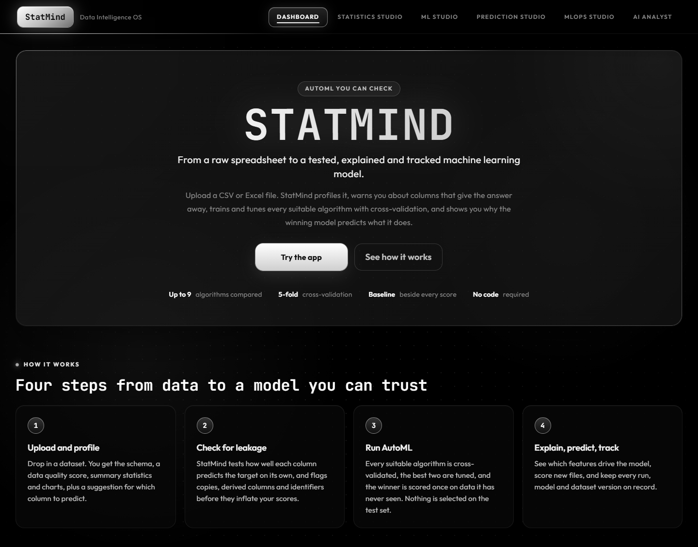
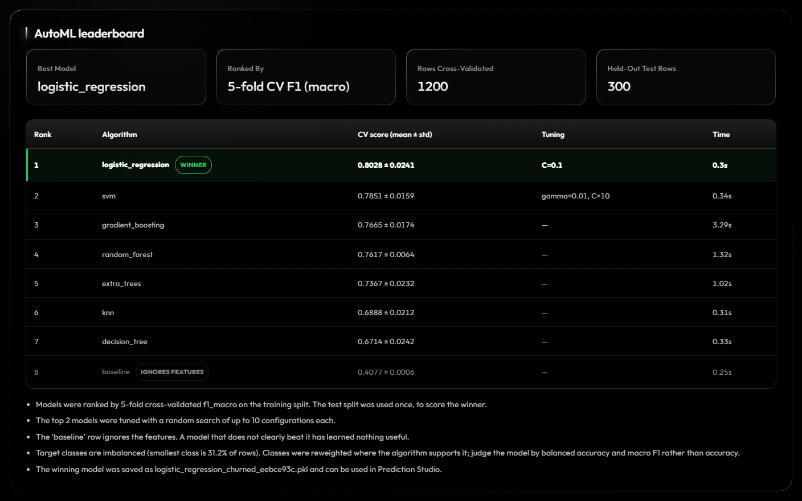
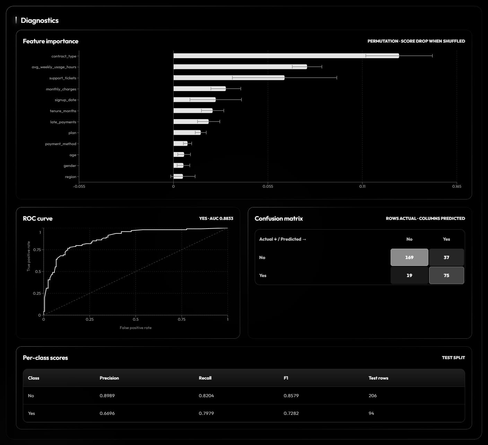
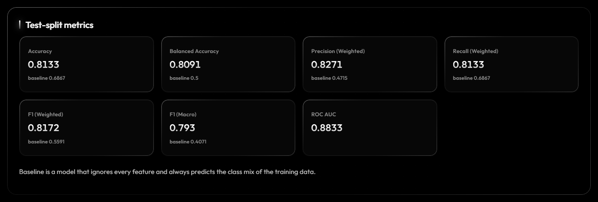
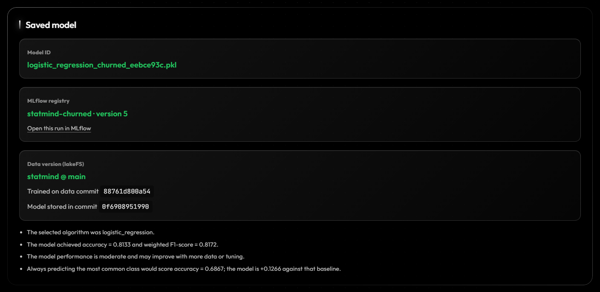
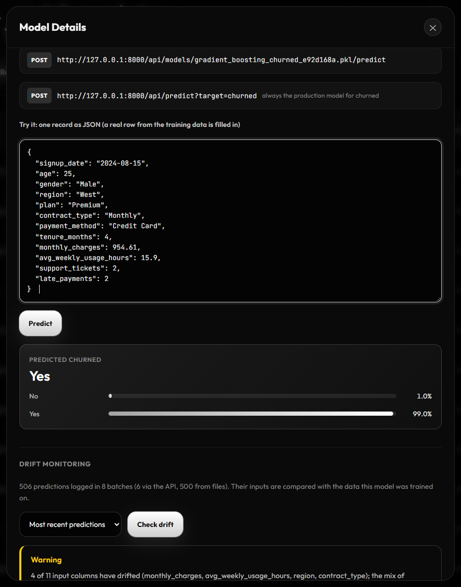
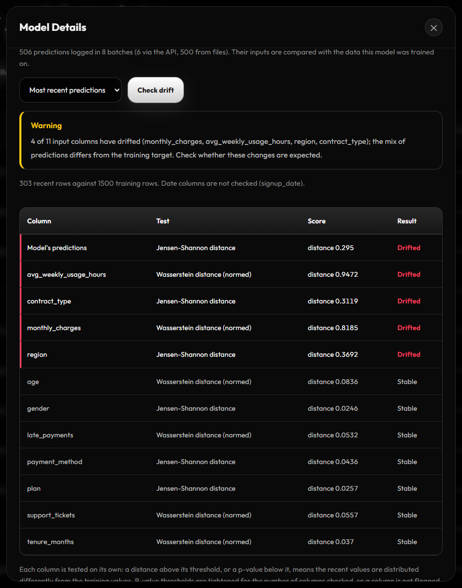
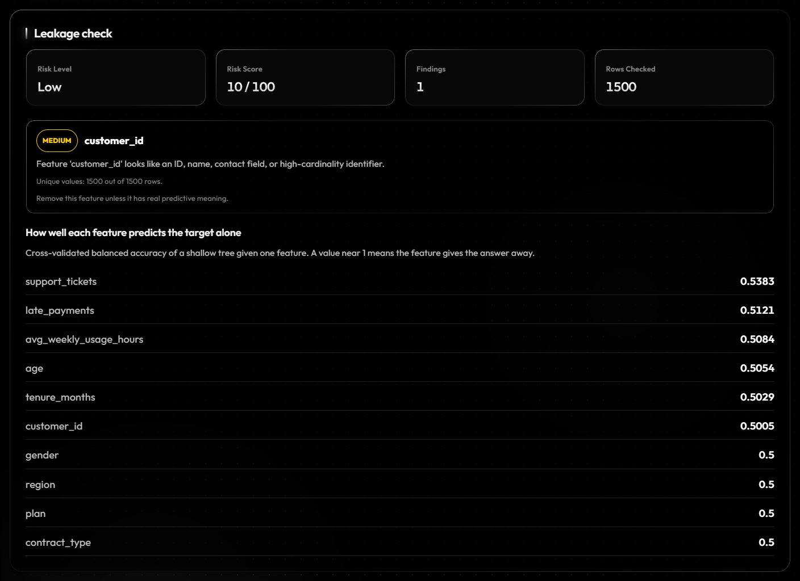
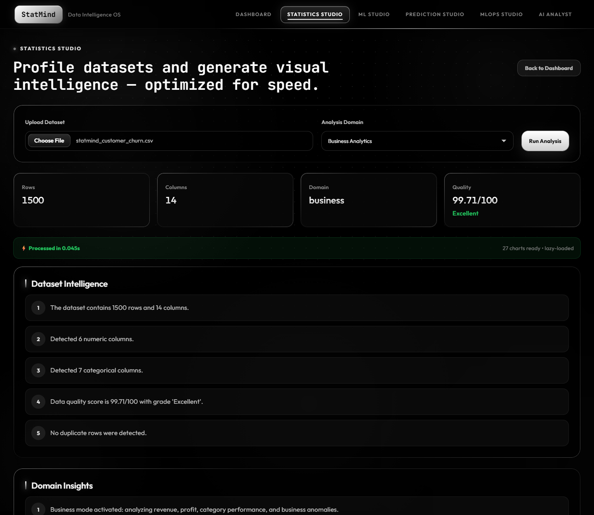

<div align="center">

```
███████╗████████╗ █████╗ ████████╗███╗   ███╗██╗███╗   ██╗██████╗      █████╗ ██╗
██╔════╝╚══██╔══╝██╔══██╗╚══██╔══╝████╗ ████║██║████╗  ██║██╔══██╗    ██╔══██╗██║
███████╗   ██║   ███████║   ██║   ██╔████╔██║██║██╔██╗ ██║██║  ██║    ███████║██║
╚════██║   ██║   ██╔══██║   ██║   ██║╚██╔╝██║██║██║╚██╗██║██║  ██║    ██╔══██║██║
███████║   ██║   ██║  ██║   ██║   ██║ ╚═╝ ██║██║██║ ╚████║██████╔╝    ██║  ██║██║
╚══════╝   ╚═╝   ╚═╝  ╚═╝   ╚═╝   ╚═╝     ╚═╝╚═╝╚═╝  ╚═══╝╚═════╝     ╚═╝  ╚═╝╚═╝
```

### **Your data walked in raw. It left with a PhD.**


</div>

---

## 🧠 What is StatMind AI?

StatMind AI is a **full-stack AutoML platform** that takes your raw CSV or Excel file and turns it into statistics, cross-validated machine learning models, predictions, leakage reports, and AI-generated insights — all in one workspace.

No Jupyter notebooks. No messy scripts. No PhD required (we handle that part).

Upload data → Get intelligence. That's it.

---

## 📸 A look inside

**Dashboard**



**AutoML leaderboard** — every algorithm cross-validated, the top two tuned, a feature-blind baseline for reference



**Model diagnostics** — permutation importance with error bars, ROC curve, confusion matrix, per-class scores



**Test-split metrics, each with the baseline's value underneath**



**Lineage** — the MLflow registry version, and the lakeFS commits holding the training data and the model



**Prediction API** — every model can be called with JSON; the production stage decides which model answers



**Drift monitoring** — recent inputs tested against the training data, column by column



**Leakage check** — how well each feature predicts the target on its own



**Statistics Studio**



Screenshots use a synthetic customer-churn dataset (1,500 rows).

**Further reading:** [a six-minute demo script](docs/DEMO.md) ·
[how the code works, module by module](docs/WALKTHROUGH.md) ·
[design decisions and their trade-offs](docs/DESIGN_DECISIONS.md) ·
[hosting a public demo](docs/DEPLOY.md)

---

## ⚡ Features That Go Crazy

### 📊 Statistics Studio
Drop a dataset and instantly get:
- Full schema detection (numeric, categorical, datetime, boolean — it figures it out)
- Data quality score with letter grade
- Numeric summary stats (mean, std, quartiles, skewness, kurtosis)
- Categorical breakdowns
- Dataset intelligence bullets generated from the actual data
- Domain-aware insights (Business / Finance / Research)
- **Auto-generated charts** — bar, pie, line, area, histogram, scatter plots, and a **correlation heatmap**

> *It doesn't just describe your data. It understands it.*

---

### 🎯 Target Advisor *(AI-Suggested Target Variable)*
Before you even touch ML, StatMind tells you **which column you should be predicting**.

- Scores every column 0–100 based on domain relevance, cardinality, missing rate, data type, and business keyword matching
- Tells you if it's a **classification** or **regression** target
- Flags identifier/contact columns that would ruin your model
- Shows reasons, warnings, and a ranked leaderboard of candidate targets
- One-click **"Use as Target"** button sends it straight to ML Studio

> *Your data has a story. StatMind finds the ending.*

---

### 🤖 ML Studio
Train real machine learning models with zero setup:

| Algorithm | Type |
|---|---|
| Random Forest | Classification / Regression |
| Extra Trees | Classification / Regression |
| Gradient Boosting (histogram-based) | Classification / Regression |
| Decision Tree | Classification / Regression |
| K-Nearest Neighbors | Classification / Regression |
| Support Vector Machine | Classification / Regression |
| Logistic Regression | Classification |
| Linear Regression | Regression |
| Ridge Regression | Regression |
| Lasso Regression | Regression |

Every trained model gives you:
- Accuracy, balanced accuracy, macro and weighted F1, precision, recall and ROC AUC, or R² / MAE / RMSE
- The same metrics for a **baseline that ignores the features**, so every score has a reference point
- **Permutation feature importance** with error bars, for every algorithm, reported per input column
- ROC curves, a labelled confusion matrix and per-class scores, or a predicted-vs-actual plot
- Auto-detected task type (classification vs regression), which you can override
- Class reweighting and a warning when the target is imbalanced
- A **saved model ID** you can reuse forever

Preprocessing is part of the saved pipeline: median / most-frequent imputation, scaling, one-hot
encoding with rare categories grouped, and date columns expanded into year, month, day of week and
elapsed days. ID-like columns are dropped.

---

### 🏆 AutoML Compare
Can't pick an algorithm? Don't.

Run **AutoML** and StatMind:

1. Sets the test split aside before anything else touches it.
2. Ranks every compatible algorithm by **5-fold cross-validation** on the training split
   (macro F1 for classification, R² for regression), reporting mean ± standard deviation.
3. **Tunes the top two** with a random hyperparameter search on the same folds.
4. Refits the winner on the whole training split and scores it **once** on the held-out test split.
5. Saves and registers the winner, so it is ready in Prediction Studio and the model registry.

The leaderboard always includes a feature-blind baseline row. On more than 5,000 training rows SVM
and KNN are skipped, and above 20,000 the cross-validation round uses a 20,000-row sample; the
winner is still refit on all training rows.

Results on the bundled benchmark datasets (`tests/data`, 80/20 split, seed 42):

| Dataset | Task | Winner | 5-fold CV | Held-out test | Baseline |
|---|---|---|---|---|---|
| Iris | 3-class | SVM (tuned) | F1 0.975 ± 0.021 | accuracy 0.967 | accuracy 0.333 |
| Breast cancer | binary | Logistic regression (tuned) | F1 0.981 ± 0.006 | accuracy 0.974, AUC 0.996 | accuracy 0.632 |
| Diabetes | regression | Lasso (tuned) | R² 0.481 ± 0.040 | R² 0.456, RMSE 53.7 | RMSE 73.2 |

> *It's like a tournament bracket, but for algorithms.*

---

### 🔮 Prediction Studio
Load any saved model ID + a new test dataset and generate predictions instantly.

- Supports CSV and Excel test files
- Returns a preview table in the UI
- Evaluates against ground truth if labels are present
- **Downloadable predictions CSV** — ready for stakeholders, reports, or flexing

---

### 🕵️ Leakage Detector
The feature that could save your entire ML project from being a lie.

StatMind analyzes your dataset for **data leakage** — columns that give the answer away in ways that would never exist in production. It flags them before you waste 3 days wondering why your model has 99.8% accuracy and fails in the real world.

- **Single-feature predictive power**: a shallow tree is cross-validated on each feature alone; a feature that nearly predicts the target by itself is flagged. This covers categorical and non-linear leaks that correlation misses.
- Exact copies of the target, and near-perfect correlation for numeric and binary targets
- Targets that are arithmetic combinations of two columns (`profit = revenue - expense`)
- ID-like columns and outcome-like column names (matched by whole word, so `paid` is not an `id`)

These are heuristics that point at columns to review; they are not proof either way.

> *"My model gets 100% accuracy" — you, before using this feature.*

---

### 💬 AI Analyst
A chat page with an embedded analyst that answers from the results StatMind has computed for your dataset — metrics, baseline, cross-validation scores, feature importance, the AutoML leaderboard and leakage findings:
- "Can I trust this model's score?"
- "Which features matter most, and why?"
- "What should I do next to improve the model?"

With `ANTHROPIC_API_KEY` set it is answered by Claude. Without a key, or if the call fails, built-in keyword rules answer instead, and the chat shows which one replied.

---

### 📄 Intelligence Report Generator
One click on the AI Analyst page. Full HTML report. Contains:
- Dataset summary and quality analysis
- Domain insights
- ML model performance and the AutoML comparison
- Leakage findings
- Recommendations

Download it. Send it. Look extremely smart in meetings.

---

### 🚀 Prediction API
Every saved model can be called over HTTP with JSON records, and answers with predictions and class
probabilities:

```bash
curl -X POST "http://localhost:8000/api/predict?target=churned" \
  -H "Content-Type: application/json" \
  -d '{"records": [{"age": 25, "plan": "Premium", "contract_type": "Monthly", "...": "..."}]}'
```

- `/api/models/{id}/predict` calls one specific model.
- `/api/predict?target=<column>` calls **whichever model is in production** for that target.
  Promoting a model in MLOps Studio retires the previous one, so callers never change anything.
- Missing columns and non-numeric values are rejected with a clear message; extra columns are ignored.
- Models are kept in memory after first use, and every request is logged for monitoring.

---

### 📉 Drift Monitoring
A model is trained on yesterday's data and used on today's. StatMind logs what each model is asked
to predict and, on request, tests those inputs against the training data with
[Evidently](https://www.evidentlyai.com/):

- One statistical test per column, with the columns that moved listed first
- The model's own predictions are compared with the target it was trained on
- A plain verdict: **stable**, **warning**, or **drift**
- The full Evidently report, with the distributions, as a download

Drift is a warning, not an accuracy figure: a column can drift harmlessly, and a model can degrade
with no drift. Measuring real accuracy needs the true outcomes.

---

### 🧬 MLOps Studio
Everything the app trains is tracked, with no setup:

- **Experiments**: every training run with its hyperparameters, test metrics and, for AutoML, cross-validation scores
- **Model registry**: every saved model, with stages you can move it through (development → staging → production → archived)
- **Datasets**: every upload, identified by content hash, so the same file is never stored twice

Two optional integrations plug real MLOps tools into the same flow (details under
[MLOps stack](#-mlops-stack)):

- **MLflow** — runs, AutoML candidates as child runs, and a model registry whose `production` alias follows the stage you set here
- **lakeFS** — a commit per dataset and per model, so each model records exactly which data it was trained on

---

## 🏗️ Architecture

```
statmind-ai/
├── backend/                  # FastAPI Python backend
│   ├── main.py               # App entry point, CORS, auth-protected routers, startup
│   ├── config.py             # All settings, from environment variables
│   ├── database.py           # SQLAlchemy models (users, datasets, jobs, ...)
│   ├── migrations/           # Alembic schema migrations (run automatically)
│   ├── worker.py             # Standalone background job worker
│   ├── manage.py             # Admin CLI: create-user, claim-legacy-data, import-local-files
│   ├── routes/
│   │   ├── auth_routes.py          # /api/auth/config, /register, /login, /me
│   │   ├── analysis_routes.py      # /api/analyze, /api/datasets
│   │   ├── target_routes.py        # /api/recommend-target
│   │   ├── ml_routes.py            # /api/train-model, /api/compare-models (jobs), registries
│   │   ├── job_routes.py           # /api/jobs
│   │   ├── prediction_routes.py    # /api/predict-test-data
│   │   ├── serving_routes.py       # /api/models/{id}/predict, /api/predict, /drift
│   │   ├── artifact_routes.py      # /api/artifacts (signed download links)
│   │   └── intelligence_routes.py  # /api/chat-analyst, /api/detect-leakage, /api/generate-report
│   └── services/
│       ├── auth.py                 # Password hashing, JWT, current-user dependency, optional login
│       ├── jobs.py, job_tasks.py   # Database-backed job queue and its tasks
│       ├── storage.py              # Local / S3 / lakeFS storage, content-addressed uploads
│       ├── lakefs_versioning.py    # lakeFS commits and data lineage (optional)
│       ├── mlflow_tracking.py      # MLflow runs and model registry (optional)
│       ├── artifacts.py            # Owned downloadable files
│       ├── ml_engine.py            # Preprocessing, training, cross-validated AutoML, explainability, predictions
│       ├── serving.py              # Online prediction API and the production model lookup
│       ├── prediction_log.py       # What each model was asked and answered
│       ├── drift.py                # Evidently drift checks against the training data
│       ├── leakage_detector.py     # Leakage checks
│       ├── ai_analyst.py           # Claude-backed analyst with a rule-based fallback
│       ├── dataset_registry.py, experiment_tracker.py, model_registry.py
│       └── ...                     # Statistics, charts, leakage, target advisor, reports
│
└── frontend/                 # React + Vite frontend
    └── src/
        ├── App.jsx           # Studios and app state
        ├── MlResults.jsx     # Model report, AutoML leaderboard, leakage report
        ├── ModelOps.jsx      # Try the prediction API and check drift, per model
        ├── AnalystPanel.jsx  # AI analyst chat and report export
        ├── AuthScreen.jsx    # Login / registration
        ├── api.js            # API client: tokens, job polling, downloads
        ├── App.css           # Base dark theme
        ├── polish.css        # Light-catching borders, motion and type refinements
        └── spotlight.js      # Pointer-following border highlight

tests/                        # pytest suite: API, auth, isolation, jobs, storage, AutoML, leakage, MLflow, lakeFS
demo/                         # Sample datasets for the demo script
start-dev.ps1                 # Starts lakeFS + MLflow + API + app locally (Windows)
```

---

## 🚀 Getting Started

### Prerequisites
- Python 3.10+
- Node.js 18+
- A dataset that deserves better than Excel pivot tables

### 1. Clone it

```bash
git clone https://github.com/inslot2525-ctrl/STATMIND-AI.git
cd STATMIND-AI
```

### 2. Backend setup

```bash
# Create and activate virtual environment
python -m venv .venv

# Windows
.venv\Scripts\activate

# macOS / Linux
source .venv/bin/activate

# Install dependencies
pip install -r backend/requirements.txt

# Start the server
cd backend
uvicorn main:app --reload --port 8000
```

Backend runs at → `http://localhost:8000`  
API docs → `http://localhost:8000/docs`

Locally this needs no extra services: SQLite, files on disk, and background jobs
run in a worker thread inside the API. MLflow and lakeFS are optional and off unless
configured. In local development there is no login
screen: everything belongs to one built-in local user. Set `AUTH_REQUIRED=true` to
turn accounts on, after which every dataset, model and experiment is private to its
owner. Production (`STATMIND_ENV=production`) always requires login.

Upgrading from a version without accounts? Your old datasets and models are kept
but have no owner yet. Create your account, then give them to it:

```bash
cd backend
python manage.py claim-legacy-data you@example.com
```

### 3. Frontend setup

```bash
cd frontend
npm install
npm run dev
```

Frontend runs at → `http://localhost:5173`

### 4. Run the tests

```bash
pip install -r backend/requirements-dev.txt
pytest            # from the repo root; uses a throwaway data dir, never your real DB
```

### Or: the full stack with Docker

```bash
docker compose up --build
```

Runs Postgres, the API, a separate job worker, an MLflow server (http://localhost:5000) and the
frontend. The compose file does not set `STATMIND_ENV`, so it runs without a login screen; add
`AUTH_REQUIRED: "true"` to the backend environment to turn accounts on.

### Configuration

| Variable | Default | Purpose |
|----------|---------|---------|
| `STATMIND_ENV` | `development` | Set to `production` to require login and refuse to start without `JWT_SECRET`. |
| `JWT_SECRET` | random per start | Signs login tokens and download links. **Required in production** (32+ random characters). |
| `ACCESS_TOKEN_MINUTES` | `720` | How long a login lasts. |
| `AUTH_REQUIRED` | `false` in development, `true` otherwise | `false` skips the login screen and runs as one local user. Cannot be `false` in production. |
| `ALLOW_REGISTRATION` | `true` | Set `false` to allow only accounts created with `manage.py create-user`. |
| `DATABASE_URL` | SQLite in `STATMIND_DATA_DIR` | Any SQLAlchemy URL. `postgres://...` URLs (Railway, Heroku) are accepted as-is. Schema migrations run automatically on startup. |
| `STORAGE_BACKEND` | `local` | `local` (files under `STATMIND_DATA_DIR`) or `s3` (AWS S3, Cloudflare R2, MinIO). Setting `LAKEFS_ENDPOINT` overrides it with lakeFS. |
| `S3_BUCKET` / `S3_ENDPOINT_URL` / `S3_REGION` / `S3_PREFIX` | — | Bucket settings for `STORAGE_BACKEND=s3`. Leave the endpoint empty for AWS; set it for R2/MinIO. Credentials come from `AWS_ACCESS_KEY_ID` / `AWS_SECRET_ACCESS_KEY`. |
| `JOB_BACKEND` | `thread` | `thread`: the API also runs jobs. `worker`: the API only queues them; run `python worker.py` separately. |
| `JOB_STALE_SECONDS` / `JOB_MAX_ATTEMPTS` | `120` / `3` | A job whose worker stops responding is retried, then failed. |
| `STATMIND_DATA_DIR` | `backend/` (Docker: `/data`) | Local files: SQLite DB, uploads, models, predictions, reports, S3 cache. |
| `MAX_UPLOAD_MB` | `50` | Maximum upload size. |
| `ALLOWED_ORIGINS` | localhost dev ports | Comma-separated CORS origins. |
| `ALLOWED_ORIGIN_REGEX` | `https://.*\.vercel\.app` | CORS origin regex; narrow it to your own Vercel project. |
| `LAKEFS_ENDPOINT` | — | Set to a lakeFS server (for example `http://127.0.0.1:8001`) to store all files through lakeFS, with a commit per dataset and per model. Replaces `STORAGE_BACKEND`. |
| `LAKEFS_ACCESS_KEY_ID` / `LAKEFS_SECRET_ACCESS_KEY` | — | lakeFS credentials. Required with `LAKEFS_ENDPOINT`. |
| `LAKEFS_REPOSITORY` / `LAKEFS_BRANCH` | `statmind` / `main` | Repository (created on first start) and branch that files are written to. |
| `LAKEFS_STORAGE_NAMESPACE` / `LAKEFS_UI_URL` | `local://<repository>` / the endpoint | Where lakeFS keeps the bytes when StatMind creates the repository (for example `s3://bucket/prefix`), and the address a browser uses for commit links. |
| `MLFLOW_TRACKING_URI` | — | Set to an MLflow server (for example `http://127.0.0.1:5000`) to also log every trained model to MLflow. Unset: StatMind uses only its own experiment tables. |
| `MLFLOW_EXPERIMENT` / `MLFLOW_UI_URL` | `statmind` / the tracking URI | MLflow experiment name, and the address a browser uses for "open in MLflow" links. |
| `ANTHROPIC_API_KEY` | — | Enables the Claude-backed AI analyst. Without it the analyst uses built-in rules. Keep it in the environment, never in the repo. |
| `ANALYST_MODEL` / `ANALYST_LLM` | `claude-opus-5-5` / `auto` | Model used by the analyst; set `ANALYST_LLM=off` to force the built-in rules. |
| `LOG_LEVEL` | `INFO` | Backend log level. |

---

## 🔌 API Reference

When login is required (`AUTH_REQUIRED=true`, always in production), every endpoint except
`/api/auth/config`, registration, login and health needs an `Authorization: Bearer <token>` header.
In local development requests without a token act as the built-in local user.

| Method | Endpoint | Description |
|--------|----------|-------------|
| `GET`  | `/api/auth/config` | Whether this server requires login |
| `POST` | `/api/auth/register` | Create an account (JSON `email`, `password`) → token |
| `POST` | `/api/auth/login` | Log in (form `username`, `password`) → token |
| `GET`  | `/api/auth/me` | The current user |
| `POST` | `/api/analyze` | Upload & profile a dataset |
| `POST` | `/api/recommend-target` | AI target variable suggestion |
| `POST` | `/api/train-model` | Start a training job → `202` + job. Optional `task_type` (`auto`, `classification`, `regression`) |
| `POST` | `/api/compare-models` | Start an AutoML job (cross-validate, tune, save the winner) → `202` + job |
| `GET`  | `/api/jobs/{id}` | Job status, progress, and result when finished |
| `POST` | `/api/predict-test-data` | Run predictions on an uploaded file with a saved model |
| `POST` | `/api/models/{id}/predict` | Predict for JSON `records` with one model |
| `POST` | `/api/predict?target=...` | Predict with the production model for a target column |
| `GET`  | `/api/models/{id}/serving` | A model's inputs, an example record, and how many predictions are logged |
| `GET`  | `/api/models/{id}/drift?window=latest\|all` | Drift verdict and per-column results |
| `POST` | `/api/models/{id}/drift/report` | Build the full Evidently HTML report → artifact id |
| `GET`  | `/api/artifacts/{id}/download-url` | Short-lived link to download a prediction CSV or report |
| `POST` | `/api/chat-analyst` | Ask the AI analyst (JSON `question`, `context`, optional `history`) |
| `POST` | `/api/detect-leakage` | Data leakage detection |
| `POST` | `/api/generate-report` | Generate HTML intelligence report |
| `GET`  | `/api/datasets`, `/api/models/`, `/api/experiments/` | Your registries |
| `POST` | `/api/models/{id}/transition?stage=...` | Move a model to `development`, `staging`, `production` or `archived` |

Full interactive docs at `/docs` (FastAPI Swagger UI; use **Authorize** to log in).

---

## 🧬 MLOps stack

Both integrations are optional and independent. Without them StatMind still tracks experiments,
models and datasets in its own database.

### One command for the local stack (Windows)

```powershell
.\start-dev.ps1          # lakeFS + MLflow + API + app, each in its own window
.\start-dev.ps1 -Plain   # just the API and the app
```

lakeFS is started only if its binary is at `.tools\lakefs\lakefs.exe`
(download the Windows zip from the [lakeFS releases](https://github.com/treeverse/lakeFS/releases)
and unpack it there). Its credentials are generated on first run into
`lakefs-data\credentials.json`, which is git-ignored.

### lakeFS: version control for data and models (optional)

[lakeFS](https://lakefs.io/) gives the stored files Git-style commits. With `LAKEFS_ENDPOINT` set:

- Every file goes through lakeFS's S3 gateway to one branch of one repository.
- **Each dataset upload is a commit**, and the dataset records its commit id.
- **Each trained model is a commit**, and the model records two ids: the commit holding the data
  it was trained on, and the commit holding the model file. Both are shown in the model report,
  stored in the model registry, and added to the MLflow run as tags.
- Any dataset can be read back exactly as it was at a commit:
  `s3://<repository>/<commit id>/uploads/<file>`.

Committing is best effort: if lakeFS rejects a commit the file is still stored and training still
succeeds, and the commit id is simply missing. Startup is strict, because without a reachable
repository nothing can be stored.

Switching an existing installation over? Files uploaded before are still on local disk. Copy them in
and commit them with:

```bash
cd backend
python manage.py import-local-files   # with the LAKEFS_* variables set
```

Not covered yet: branching per experiment, and merging or reverting from the StatMind UI (use the
lakeFS UI or `lakectl`). Prediction CSVs and reports are stored through lakeFS but only committed
along with the next dataset or model.

### MLflow (optional)

StatMind keeps its own experiment log and model registry. Point it at an MLflow server and every
trained model is logged there as well:

```bash
# terminal 1: MLflow UI and registry at http://127.0.0.1:5000
mlflow server --port 5000 --backend-store-uri sqlite:///mlflow.db --artifacts-destination ./mlartifacts

# terminal 2: the StatMind API, logging to it  (PowerShell: $env:MLFLOW_TRACKING_URI = "...")
cd backend
MLFLOW_TRACKING_URI=http://127.0.0.1:5000 uvicorn main:app --port 8000
```

- **Runs**: parameters, hyperparameters, test metrics, the baseline's metrics and cross-validation
  scores, plus feature importance, diagnostics and schema as JSON artifacts.
- **AutoML**: the winner is the parent run and every candidate on the leaderboard is a child run,
  so the whole comparison can be charted in MLflow.
- **Registry**: each model becomes a new version of `statmind-<target column>`. Moving a model to
  staging or production in MLOps Studio moves the matching MLflow alias, so
  `models:/statmind-<target>@production` always loads the model StatMind has in production.
- If the MLflow server is down, training still succeeds; the run is simply not logged there.

Models are stored in MLflow with cloudpickle and include StatMind's own preprocessing classes, so
loading one outside this codebase needs `backend/` on the Python path. `docker compose up` starts
an MLflow service and wires it up automatically.

---

## 🚢 Deploying (e.g. Railway)

Step-by-step instructions for Railway + Vercel are in [docs/DEPLOY.md](docs/DEPLOY.md). In short:

1. Add a **Postgres** database; set `DATABASE_URL` on the API.
2. Create a bucket on **Cloudflare R2** (or S3); set `STORAGE_BACKEND=s3` and the `S3_*` / `AWS_*` variables.
   Without a bucket, attach a persistent volume at `/data` instead.
3. Set `STATMIND_ENV=production`, a long random `JWT_SECRET`, and `ALLOWED_ORIGIN_REGEX` for your Vercel URL.
4. For heavy training, set `JOB_BACKEND=worker` and add a second service from the same image with start command `python worker.py` and the same variables.
5. Optional: set `ANTHROPIC_API_KEY` for the Claude-backed analyst, and `MLFLOW_TRACKING_URI` / `LAKEFS_*` if you run those services.

---

## 🧪 Supported File Formats

| Format | Extension |
|--------|-----------|
| CSV | `.csv` |
| Excel 2007+ | `.xlsx` |
| Excel 97-2003 | `.xls` |

---

## 🎨 Tech Stack

**Backend**
- [FastAPI](https://fastapi.tiangolo.com/) — async Python API framework
- [SQLAlchemy](https://www.sqlalchemy.org/) + [Alembic](https://alembic.sqlalchemy.org/) — SQLite / PostgreSQL with migrations
- [PyJWT](https://pyjwt.readthedocs.io/) + argon2 ([pwdlib](https://frankie567.github.io/pwdlib/)) — accounts and tokens
- [boto3](https://boto3.amazonaws.com/) — S3 / R2 / MinIO storage
- [scikit-learn](https://scikit-learn.org/) — ML algorithms, cross-validation, tuning, permutation importance
- [Anthropic SDK](https://github.com/anthropics/anthropic-sdk-python) — Claude-backed AI analyst (optional)
- [Evidently](https://www.evidentlyai.com/) — drift tests and reports
- [MLflow](https://mlflow.org/) — experiment tracking and model registry (optional)
- [lakeFS](https://lakefs.io/) — version control for datasets and models (optional)
- [pandas](https://pandas.pydata.org/) — data manipulation
- [numpy](https://numpy.org/) — numerical computing
- [uvicorn](https://www.uvicorn.org/) — ASGI server
- [joblib](https://joblib.readthedocs.io/) — model persistence

**Frontend**
- [React 19](https://react.dev/) — UI framework
- [Vite 8](https://vitejs.dev/) — blazing fast build tool
- [Recharts](https://recharts.org/) — chart library

---

## 🗺️ Roadmap

- [x] User accounts (JWT) with per-user data isolation
- [x] PostgreSQL + migrations, S3/R2 storage, background jobs
- [x] Cross-validated AutoML with tuning, baselines and a saved winner
- [x] Model-agnostic explainability (permutation importance, ROC, confusion matrix)
- [x] LLM-backed AI analyst
- [x] MLflow experiment tracking and model registry
- [x] lakeFS data versioning with dataset-to-model lineage
- [ ] OAuth login (Google / GitHub) and password reset
- [ ] Time series forecasting module
- [ ] NLP / text column analysis
- [ ] Per-prediction explanations (SHAP values)
- [x] Prediction API with a production stage, and drift monitoring
- [ ] Automatic retraining when drift is detected
- [ ] lakeFS branches per experiment, with merge and revert from the UI
- [ ] Multi-file join and merge studio
- [ ] Export to Jupyter Notebook
- [x] Docker images, compose stack and Railway / Vercel deploy configs
- [ ] Public hosted demo

---

## 🤝 Contributing

Pull requests are welcome. For major changes, open an issue first so we can argue about it in a civilized manner.

1. Fork the repo
2. Create your feature branch: `git checkout -b feature/something-wild`
3. Commit your changes: `git commit -m 'Add something wild'`
4. Push to the branch: `git push origin feature/something-wild`
5. Open a pull request

---

## 📜 License

MIT — do whatever you want with it. Build a startup. Win a hackathon. Impress your professor.

---

<div align="center">

**Built with unreasonable ambition and a lot of caffeine.**

*StatMind AI — because your data deserves better than a spreadsheet.*

</div>
